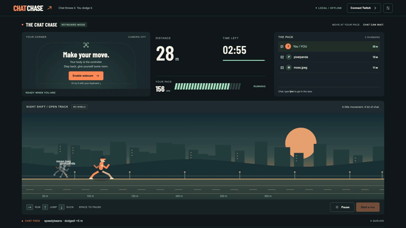

# Chat Chase

**Chat throws it. You dodge it.**

Run in place, jump over walls and squat under bars. Your webcam drives the runner. Twitch chat brings obstacles, shields and ghost racers. No backend, database, client secret or extra hardware.



[View the full desktop interface](preview.png) · [Watch the local gameplay preview](demo.mp4)

## Play in a minute

Requires Node.js 22.12+ and npm, desktop Chrome, and an internet connection for first-time pose model loading.

```sh
npm install
npm run dev
```

Open **http://localhost:5173/?demo=1**. Start a run. Hold **→** to run, press **↑** to jump, hold **↓** to duck. Use the demo buttons to join racers, send obstacles and power-ups. **Space** pauses, **D** toggles motion debug graphs, **backtick** opens streamer controls. Keyboard mode starts without camera or Twitch permission.

On macOS, you can also double-click `Start Chat Chase.command` from the project folder.

For body control, choose **Enable webcam**, allow access, then stand still for three seconds with shoulders, hips, knees and feet visible. Stand roughly 2–3 m away in a clear, well-lit space. Calibration restarts if the body moves substantially or leaves frame. After calibration, start a run. Recalibrate after moving the camera.

A run defaults to three minutes. Distance follows cadence, a wall needs a jump, and a bar needs a squat. Every obstacle has two seconds of warning and names its sender. A dodge awards 5 m. A hit costs 3 m and slows the avatar for two seconds. A shield absorbs one hit; Sprint Zone doubles distance for 20 seconds. There is no game over.

## Twitch setup

1. Register an application at [Twitch Developer Console](https://dev.twitch.tv/console/apps). Choose a public client for browser implicit OAuth, if asked.
2. Set the OAuth redirect to exactly `http://localhost:5173/` (including trailing slash).
3. Copy `.env.example` to `.env`. Set `VITE_TWITCH_CLIENT_ID` to your client ID and `VITE_TWITCH_REDIRECT_URI` to that exact redirect. **Never add a client secret.**
4. Restart the dev server, open the app at that same origin, and choose **Connect Twitch**. Sign in as the broadcaster.
5. Start a run and try `!join`, `!wall` and `!bar` from another viewer account. Non-Affiliate channels can still use chat; failed bits, subscription or redemption subscriptions are logged independently under streamer controls.

The app requests `user:read:chat user:write:chat bits:read channel:read:subscriptions channel:read:redemptions`. OAuth state is verified before storing an incoming access token. Tokens stay in sessionStorage, are removed from the address bar immediately, and are validated with Twitch. Disconnect clears the token. No token or secret is shipped in source.

EventSub handles keepalives, watchdog reconnects, reconnect URL transfer, revocations, and message-ID deduplication. Subscription failures do not stop the others. Outgoing messages batch joins and cap posts at one per five seconds; disable them in controls.

### Viewer commands and events

| Input | Effect |
| --- | --- |
| `!join` | Enter this run as a ghost racer |
| `!go` | Boost your ghost for 4 s; 10 s viewer cooldown |
| `!wall`, `!bar` | Queue an obstacle; shared 60 s viewer cooldown |
| Cheer | 1 obstacle per 100 bits by default, maximum 3 |
| Subscribe / gift sub | Give the streamer a shield, maximum 1 held |
| Reward “Drop an obstacle” | Queue a wall; bypass viewer cooldown |
| 5 accepted obstacle events in 30 s | 20 s of double-distance Sprint Zone |

Settings include reward title, bits per obstacle, hype threshold, role restriction, run/rest lengths, spacing, intensity and demo event frequency. All obstacles, including paid events and redemptions, pass through the same caps. No rewards are automatically created in the Twitch account.

## OBS

Use **Window Capture** on the Chrome game window, not OBS Browser Source. Only the game needs to open the webcam; avoid simultaneously opening the same webcam device in OBS, especially on Windows. At 1920×1080, crop the browser chrome and optionally crop the demo controls below the feed. Close streamer controls before capture. No server overlay is needed. A backtick toggles the controls out of the captured game area.

## Twitch CLI mock testing

Install the [official Twitch CLI](https://dev.twitch.tv/docs/cli/). Start the mock server in one terminal:

```sh
twitch event websocket start-server
```

In `.env.local`, set:

```dotenv
VITE_TWITCH_WS_URL=ws://127.0.0.1:8080/ws
VITE_TWITCH_SUBSCRIPTIONS_URL=http://127.0.0.1:8080/eventsub/subscriptions
VITE_TWITCH_MOCK_USER_ID=1234
```

Restart Vite. The loopback-only mock connection uses a dummy identity without OAuth; real chat output stays off. Start a run. In another terminal:

```sh
twitch event trigger channel.chat.message --transport=websocket
twitch event trigger channel.cheer --transport=websocket
twitch event trigger channel.subscribe --transport=websocket
twitch event trigger channel.subscription.gift --transport=websocket
twitch event trigger channel.channel_points_custom_reward_redemption.add --transport=websocket
twitch event websocket reconnect
```

The official CLI v1.1.24 predates `channel.chat.message` and rejects that subscription/trigger. This is shown in the log without affecting the other four subscriptions. Use a CLI release supporting chat, a real channel, or the demo buttons to test chat commands; mocked transport tests also cover chat notifications. For a deterministic redemption, append `--item-name 'Drop an obstacle'`; for a cheer append `--cost 300`. See [Twitch's WebSocket testing guide](https://dev.twitch.tv/docs/cli/websocket-event-command/) for transport flags, keepalive and revocation testing. Remove `.env.local` before returning to real Twitch.

## Safety

You control how much you move. Chat changes the game only. Chill / Normal / Spicy cap obstacles at 6 / 10 / 15 per sliding minute. Spacing is at least 2.5 s; the pending queue holds at most eight effects and visibly drops overflow. Pause freezes simulation time and the queue. Leaving camera view for more than one second, switching tabs, or moving focus away pauses a live race. A rest break follows every run and cannot be shortened below 30 seconds. Repeated events do not stack shields or bypass obstacle caps. Presets and thresholds are configurable; start with Chill.

## Development and checks

```sh
npm test          # pure rules, synthetic motion replay and mocked Twitch transport
npm run build     # strict TypeScript + production bundle
npm run preview   # serve production output
npm run format    # format source
```

`motion/`, `game/` and `effects/` have no DOM or network dependencies. `pose/`, `twitch/`, `render/` and `main.ts` adapt those modules to the browser. Settings persist locally. Webcam frames are processed locally by MediaPipe; recording exports landmarks only, never video.

Under **Controls → Motion tuning & recording**, record up to 30 s, save JSON, and replay it through the live detector. Committed fixtures in `tests/fixtures/` are explicitly **synthetic regression fixtures**, not real motion recordings. Replace or supplement them with consented webcam captures when performing the manual acceptance tests.

## Validation boundaries

Automated tests and browser checks do not establish physical detection accuracy or mid-range-laptop frame rate. The ≥90% jump/squat target, absence of false jumps during real running, ≥30 fps with pose, and real non-Affiliate Twitch end-to-end behavior need a physical camera/account session. See [VALIDATION.md](VALIDATION.md). Model and WASM load from Google/jsDelivr over HTTPS on first camera startup; the keyboard/demo game works without those downloads.

## Demo and submission

[DEMO.md](DEMO.md) contains a timed video script under three minutes, including the required safety controls. `demo.mp4` is a local keyboard/demo-mode preview, not evidence of webcam recognition or real Twitch operation. Upload a final webcam + Twitch demonstration publicly to YouTube and put its URL in your submission. The app cannot publish to YouTube without an authorized account connection.

## Built with Codex

Codex read the product specification, authored the TypeScript game, motion processing, UI, Twitch adapters, tests and documentation, ran automated checks and browser interactions, and captured the demo assets. The original requested scope is preserved in [SPEC.md](SPEC.md). Human validation remains necessary for camera performance and live Twitch permissions.

Technical references: [MediaPipe Pose Landmarker](https://ai.google.dev/edge/mediapipe/solutions/vision/pose_landmarker/web_js), [Twitch browser chat authentication](https://dev.twitch.tv/docs/chat/authenticating), [EventSub subscription types](https://dev.twitch.tv/docs/eventsub/eventsub-subscription-types), [WebSocket handling](https://dev.twitch.tv/docs/eventsub/handling-websocket-events).
